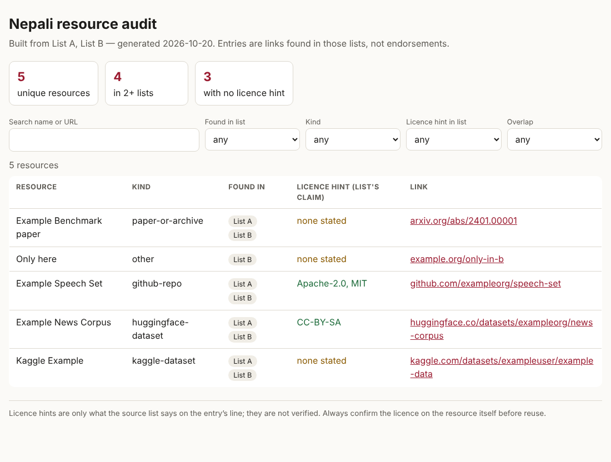
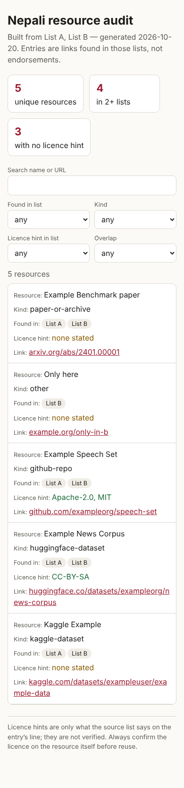
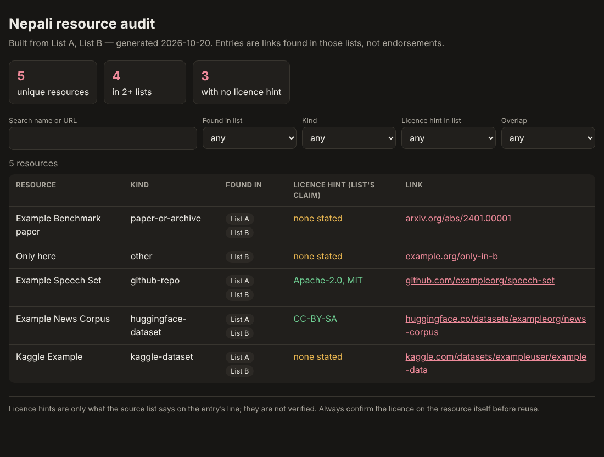

# nepali-resource-audit

A small, dependency-free tool that **audits community lists of Nepali datasets and resources**: it merges the same
resource linked in different ways, measures overlap between lists, reports which entries state a licence, and (opt-in)
checks link health and looks up the licence a host (GitHub / Hugging Face) declares. It can also build a static,
searchable page from the result.

> **Status: v0.1, early.** It reads Markdown lists with regexes; unusual formatting can be missed. Licence "hints"
> are only what a list says on an entry's line and are **not** verified licences.

## Why
The Nepali community already maintains several useful lists of datasets and papers. Reading four of them
(see [docs/FINDINGS.md](docs/FINDINGS.md)) showed that they overlap heavily — **965 link mentions → 575 unique
resources, 157 in two or more lists** — and that **none of the 575 entries states a licence on its own line**, so a
researcher cannot tell from the list alone whether data may be reused. Rather than publish yet another list, this
tool measures and maintains the ones that exist. (Findings are specific to the four READMEs at the commits listed
there, from an offline run.)

## Features
- Extracts links from Markdown (bullets, tables, bare URLs; skips code blocks and badges) with section, entry name,
  list-reported "✓" marks, and licence hints.
- Canonicalises URLs: GitHub/Hugging Face/Kaggle (old and new URL styles)/arXiv (abs/pdf/versions)/DOI, UTM removal.
- Summary: unique resources, per-list counts, repeats inside a list, pairwise overlap, kinds, licence-hint coverage,
  conflicting hints.
- **Opt-in** `--check-links`: HEAD→GET, redirects, per-host rate limit, polite User-Agent. Distinguishes `dead`
  (404/410) from `unverifiable` (401/403/405/429 — never reported as dead).
- **Opt-in** `--lookup-licenses`: GitHub repository licence and Hugging Face dataset/model card licence, reported
  separately as "declared by the host".
- `--site`: single-file static HTML (search, filter by list/kind/licence hint/overlap), light/dark, responsive,
  accessible labels, no external requests, data inserted with `textContent` only.

## Install and use
Python ≥ 3.10, no runtime dependencies.
```bash
git clone https://github.com/iamnarace/nepali-resource-audit && cd nepali-resource-audit
python -m venv .venv && . .venv/bin/activate
pip install -e ".[dev]"

# offline audit of two Markdown lists, plus a static site
nra audit --source "List A=tests/fixtures/list_a.md" --source "List B=tests/fixtures/list_b.md" --out out --site

# against real lists (clone them yourself; respect their licences)
nra audit --source pemagrg1=Nepali-Datasets/README.md --source iost=nepali-datasets/README.md --out out
# with network (slow, rate-limited; sends requests to every host in the lists):
nra audit --source ... --out out --check-links --lookup-licenses
```
Outputs: `out/catalogue.json`, `out/report.md`, optionally `out/site/index.html`. Open the HTML file directly.

Sample output on the bundled fixtures (invented example URLs): `9 mentions -> 5 unique; 4 in 2+ lists`.

### Screenshots (generated from the bundled *fixture* data, not real lists)
| desktop | mobile | dark |
|---|---|---|
|  |  |  |

## Development
```bash
ruff check . && python -W error -m pytest -q      # 39 tests
```
Tests include a local HTTP server for link-state logic (ok/404/403/500/redirect/HEAD-rejected) and a check that
hostile strings in list data cannot break out of the page's data block. The live-internet paths (GitHub/Hugging Face
lookups) are tested with an injected fake fetcher only; **they have not been run against the real services**
(unavailable in the build environment).

Layout: `src/nepali_resource_audit/{urls,extract,audit,links,report,site,cli}.py`.

## Data, licence, privacy
- Code: Apache-2.0 (`LICENSE`, `NOTICE`). The repository bundles **no third-party list content**: fixtures are invented.
- Network access happens only with `--check-links` / `--lookup-licenses`; the tool sends no data about you, only
  HEAD/GET requests to the listed URLs and API requests to api.github.com / huggingface.co. Unauthenticated GitHub API
  calls are limited to ~60/hour; large lists need a different approach (see roadmap).
- Respect robots/terms of the sites you check; keep `--workers` low.

## Known limitations
- Regex extraction of Markdown; HTML-in-Markdown and reference-style links are not handled.
- Licence hints come from keyword matching on one line; a neighbouring link's licence can be mis-attributed (conflicts
  are reported for manual review).
- GitHub merging is repository-level, so different subfolders of one repo count as one resource.
- Kaggle licences are not looked up (no unauthenticated API). Google Drive/paywalled links are `unverifiable`.
- No history/diff between runs yet.

## Roadmap
GitHub token support (env var name, like nepali-eval), `nra diff` between runs, GitHub Action template that comments
link-rot on a list's pull requests, YAML catalogue export (id, licence, provenance) that list maintainers can adopt.

## Contributing
See [CONTRIBUTING.md](CONTRIBUTING.md). If you maintain one of the audited lists and want it handled differently,
open an issue — no endorsement by any list maintainer is implied.

## Acknowledgements
Developed with assistance from Claude. The audited lists are the work of their respective authors
(pemagrg1, theranjitraut, IOST-ASCOL, ghimiresunil).
